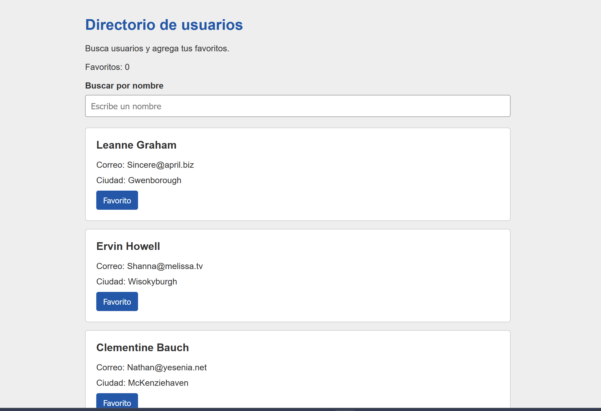
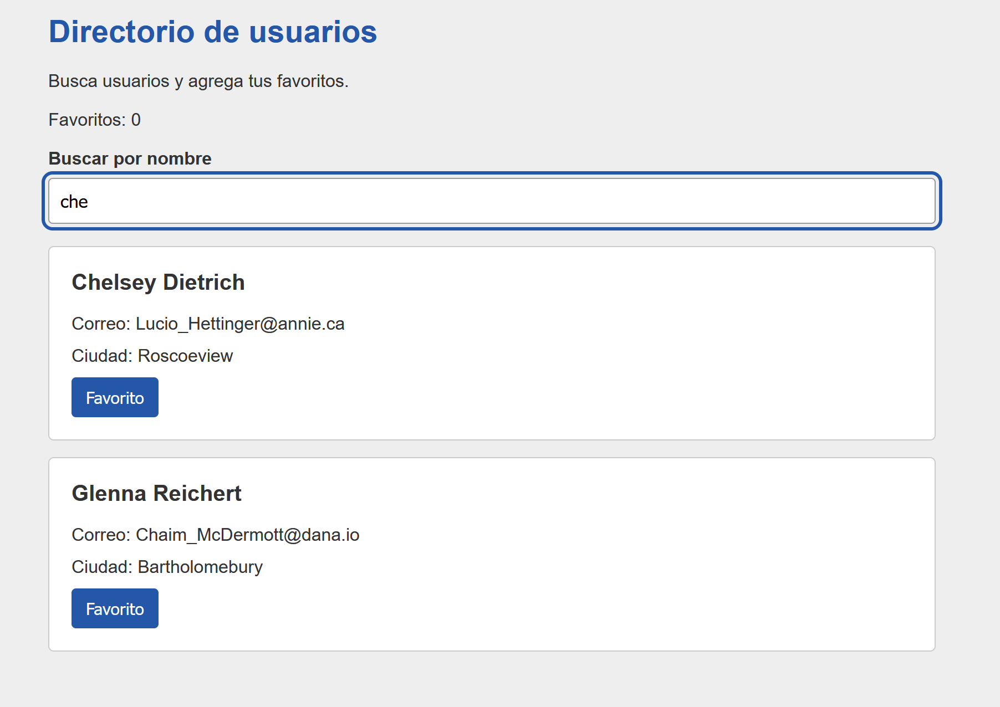
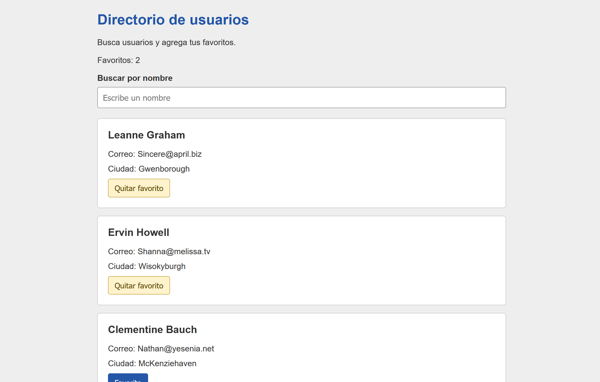
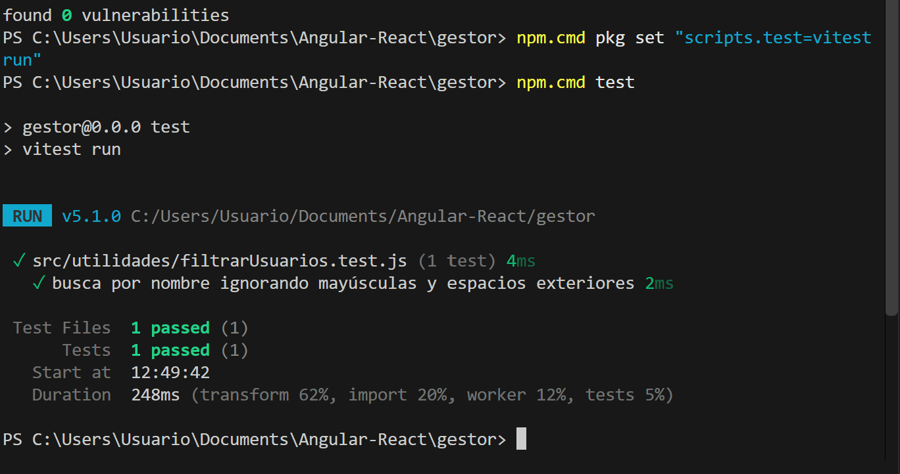
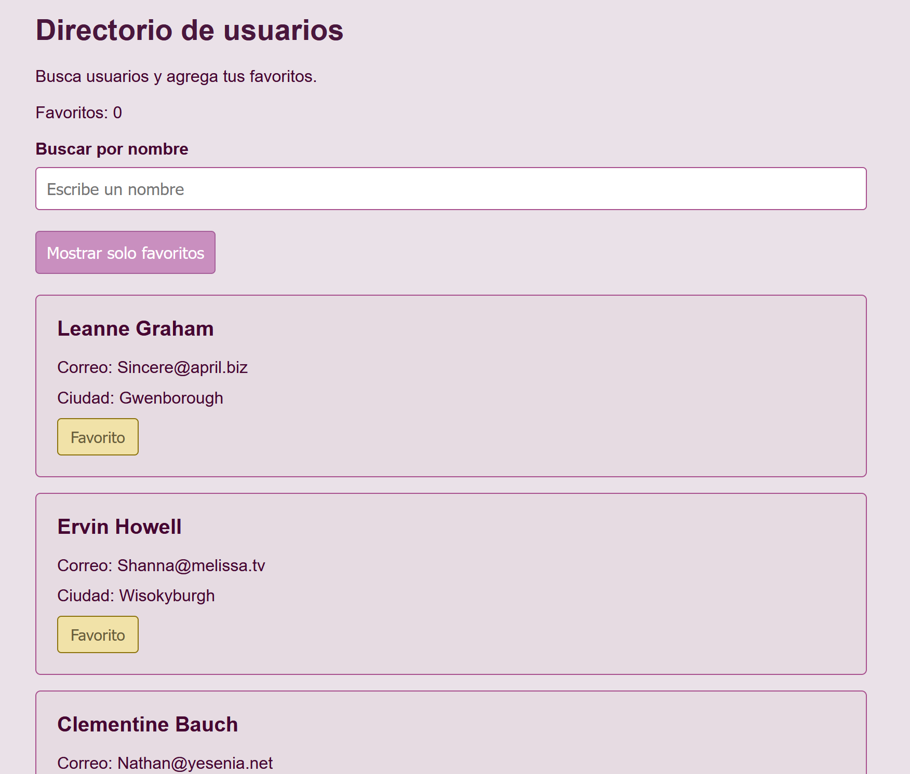
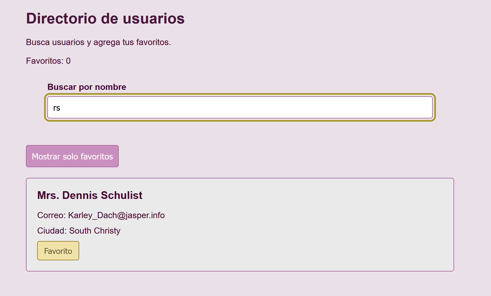
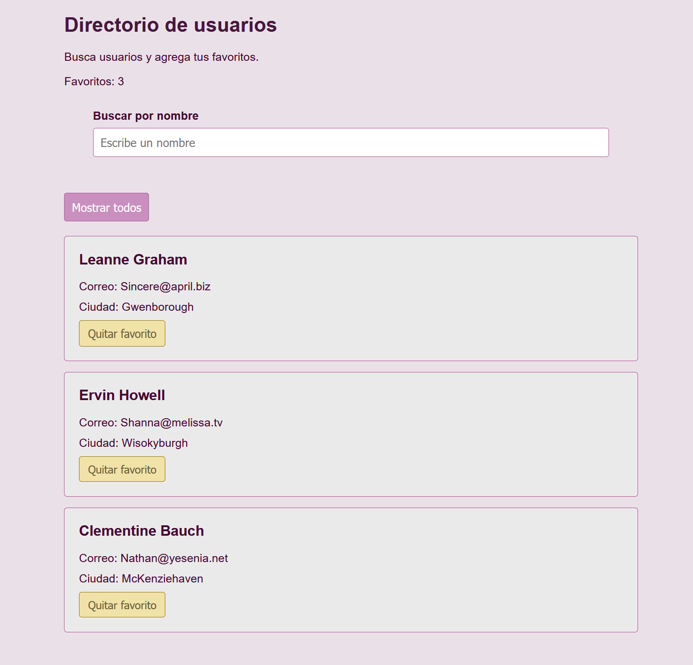
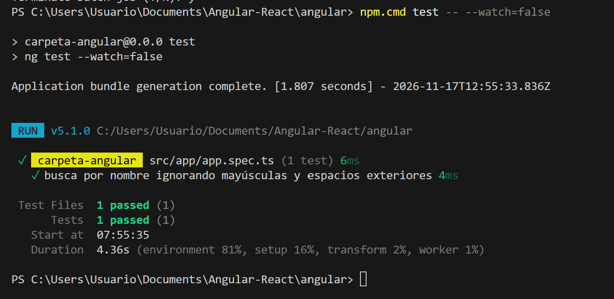

## Organización

- `angular/` contiene el proyecto Angular.
- `gestor/` contiene el proyecto React.
- `evidencias/` contiene las imagenes de evidencias de ambos frameworks
- Cada proyecto tiene sus propias dependencias y comandos.


## API utilizada

https://jsonplaceholder.typicode.com/users

Las aplicaciones realizan consultas GET. Los favoritos se gestionan
localmente en cada aplicación.


## Ejecutar React

Desde la carpeta principal del repositorio, ejecutar los siguientes comandos
por separado.

```
cd gestor
npm.cmd ci
npm.cmd run dev
```

Abrir la dirección que muestra la terminal.
Normalmente es http://localhost:5173.

## Ejecutar Angular

Abre otra terminal en la carpeta principal del repositorio.

```
cd angular
npm.cmd ci
npm.cmd start
```

Abrir la dirección que muestra la terminal.
Normalmente es http://localhost:4200.

## Pruebas unitarias

Cada proyecto incluye una prueba de la función `filtrarUsuarios`.

La prueba comprueba que una búsqueda por nombre parcial funcione
con mayúsculas y espacios al inicio y al final.

### React

Ejecuta desde la carpeta `gestor`.


npm.cmd vitest run


### Angular

Ejecuta desde la carpeta `angular`.


npx.cmd ng test --watch=false


## Compilación

Ejecuta el siguiente comando dentro de cada proyecto.


npm.cmd run build


## Evidencias de React

### Usuarios cargados



### Búsqueda por nombre



### Filtro y contador de favoritos



### Prueba unitaria



## Evidencias de Angular

### Usuarios cargados



### Búsqueda por nombre



### Filtro y contador de favoritos



### Prueba unitaria


